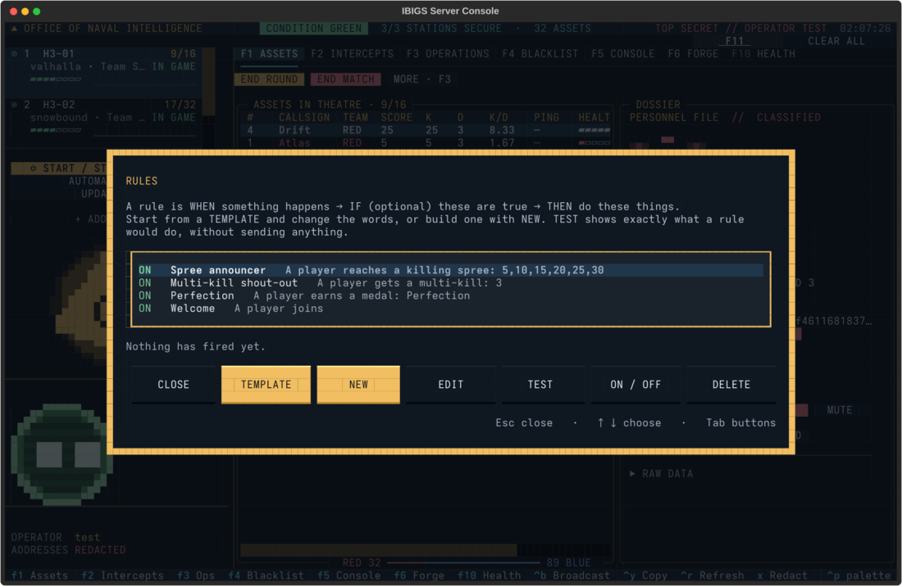
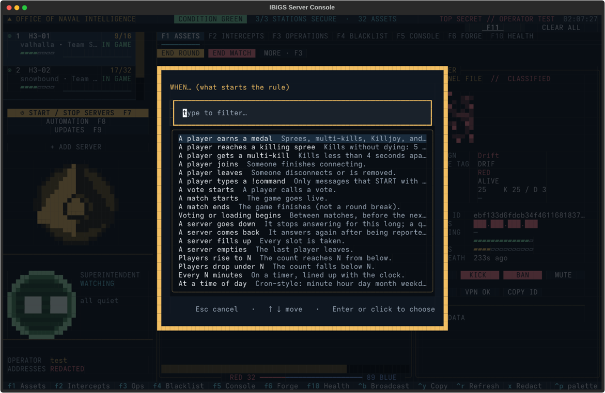

# Automation: rules, roles, votes and Discord

Press **F8** in `oni` to open **AUTOMATION**. Everything you set up there keeps running on your server even when
you close `oni` or log out.

| Section | What it's for |
|---|---|
| **RULES** | When something happens, do something. For example, announce killing sprees, page an admin, or post to Discord when a server goes down. |
| **SCHEDULES** | Do something at set times: reminders, nightly restarts, updates. |
| **ROLES** | Make players **ADMIN**, **VIP** or **MOD**. |
| **VOTES** | Turn player voting on or off for each server. |
| **DISCORD** | Connect a Discord channel so rules can post in it. |

## Rules

Every rule reads like a sentence:

> **WHEN** something happens → **IF** (optional) these things are true → **THEN** do these things.

For example: *WHEN a player types `!admin` → IF an admin is online → THEN message the admins privately.*

### The quickest start: templates

Choose **TEMPLATE**, pick one, change the words if you like, and save. The templates are:

- **Spree announcer**: "Alpha is on a Killing Frenzy! (10 kills)"
- **Multi-kill shout-out**: "Overkill by Alpha!"
- **Perfection**: tells every server when someone wins a match without dying
- **First blood**: "First blood: Alpha took out Bravo!"
- **Sniper shout-out**: a sniper kill by someone on a 3+ K/D
- **Lag alert**: tells the admins, and Discord, when a server drops under 40 fps
- **Welcome**: a private hello to each player who joins
- **!admin call**: a player types `!admin <problem>` and every online admin gets a private message, wherever they're playing
- **!admin with nobody on**: the same, but pings Discord when no admin is online
- **Server down: tell the admins**: in game and on Discord
- **Full server alert**: tells the admins when a server is full
- **Empty server: point people elsewhere**
- **VIP kick protection**: always on anyway; see Roles below

### Building your own

Choose **NEW**. You pick from menus, so there's nothing to type except names and messages.

**WHEN: what starts the rule**

| Choice | Notes |
|---|---|
| A player earns a medal | Any of: Killing Spree, Killing Frenzy, Running Riot, Rampage, Untouchable, Invincible, Double Kill, Triple Kill, Overkill, Killtacular, Killtrocity, Killimanjaro, Killtastrophe, Killpocalypse, Killionaire, Killjoy, Perfection. You can pick "any". |
| A player reaches a killing spree | Choose your own counts, like `5,10,15` or `3,7`. |
| A player gets a multi-kill | Kills less than 4 seconds apart: 2 is a Double Kill, 3 a Triple Kill, 4 an Overkill. |
| A player gets a kill with a weapon | Part of the name is enough: `sniper`, `sword`, `rocket`, `melee`, `grenade`. |
| First blood | The first kill of a match. |
| A player reaches N kills in a match | |
| A player betrays a teammate | Rules can only talk about it; nothing punishes anyone. |
| A server's frame rate drops under N / is back to N or more | From the server's own minute-by-minute report (60 is perfect, under 54 players notice, under 40 is laggy). See [Is my server lagging?](SERVER-PERFORMANCE.md). |
| A player joins / leaves | |
| A player types a !command | Only messages that **start** with the command count, like `!admin`. Ordinary chat never triggers anything. |
| A vote starts | Any vote, or just kick, end-round, end-game, shuffle or playlist votes. |
| A match starts / ends, voting or loading begins | |
| A server goes down / comes back | "Down" means it stopped answering for at least as long as you choose (60 seconds by default), so a quick restart doesn't count. A server you stopped yourself with F7 isn't "down". |
| A server fills up / empties | |
| Players rise to N / drop under N | |
| Every N minutes / at a time of day | |

**IF: only when these are true** (optional, up to 8)

- The player count is between two numbers
- An admin is online (anywhere, on this server, or on another server), or no admin is online
- The player has a role (ADMIN, VIP, MOD or none)
- The player's kills/deaths this match is at least a number (with a minimum number of kills)
- The day of the week
- The server's frame rate is under a number
- Another server's player count is between two numbers
- The map or game mode is something (part of the name is enough)
- The time is between two times
- Another server is up, down, full or empty

**THEN: what to do** (1 to 8 things, in order)

- Say something in chat on this server, every server, the other servers, or one specific server
- Message the player privately
- Message the admins privately, wherever they're playing
- Message everyone with a role (all VIPs, for example)
- Cancel the vote
- Shuffle the teams (only during a match)
- Start a stopped server
- Post to Discord
- Wait a few seconds before the next step

**Messages** can include these words in curly brackets, which get filled in:

| Word | Becomes |
|---|---|
| `{player}` | the player |
| `{server}` | this server |
| `{count}`, `{max}` | players on it, and its slots |
| `{medal}`, `{kills}` | the medal, and the spree or multi-kill count |
| `{map}`, `{mode}` | the current map and game mode |
| `{admins}` | the admins online |
| `{target}` | who a vote is against |
| `{weapon}`, `{victim}`, `{kd}` | for kills: the weapon, who was killed, and the killer's K/D this match |
| `{fps}` | the server's frame rate |
| `{args}` | what someone typed after a !command |
| `{down}` | the server that went down |
| `{time}` | the time |

### Examples of what people build

- **Admin on another server:** WHEN a server goes down → THEN message the admins on other servers: "Heads up: {down} is down."
- **Full server:** WHEN a server fills up → THEN post to Discord: "{server} is full ({count}/{max})."
- **Empty server:** WHEN players drop under 2 → THEN say "Quiet here! Try our other servers."
- **Big sprees go fleet-wide:** WHEN a player reaches a killing spree at `15,20,25,30` → THEN say on every server: "{player} is on a {medal} on {server}!"
- **No kick votes at all:** WHEN a vote starts (kick) → THEN cancel the vote, and say "Kick votes are off here. Type !admin."
- **Rules reminder:** every 20 minutes → say "Be nice. Type !admin if someone's cheating."

### TEST, limits and history

- **TEST** shows exactly what a rule would do right now, with an example player, and sends nothing.
- **Limits:** each rule has a wait between runs (per server and per player) and a maximum per hour. Medals and joins
  have no wait by default; alerts wait 30 seconds. On top of that, rules never send a server more than 20 messages a
  minute, so a mistake can't flood your chat.
- **History:** the bottom of RULES shows what fired recently and whether it worked.
- **ON / OFF** pauses a rule without deleting it. Changes take effect within a few seconds.

### What rules can't do

Rules can talk, cancel votes, shuffle teams and start stopped servers. They **can't** kick, ban, mute, restart busy
servers or run commands. Nothing reacts to what people say in chat except `!commands` typed on purpose. Kicks and bans
stay with a person.

## Roles

Open **ROLES** and choose **ADD**. Pick someone who's online, or paste their player ID. On **F1**, select the player
and press **e** to go straight there; their dossier shows the ID, and **Ctrl+Y** copies it.

| Role | What it does |
|---|---|
| **ADMIN** | In-game admin powers. The server only reads its admin list when it starts, so `oni` writes it in the **next time that server is empty** and restarts it then. Nobody gets disconnected. ROLES shows which servers are still waiting. |
| **VIP** | **Can't be vote-kicked**, starting right away: any kick vote against a VIP is cancelled with a message. More VIP perks arrive with future Project Reclaimer builds. |
| **MOD** | Saved now. It starts working when Project Reclaimer adds moderators. |

A role can apply to every server or just one. Admins you added to `dedicated.toml` by hand are never removed; `oni`
only ever takes out IDs it added itself. Every change is backed up first, in `.oni-backup/` next to the file.

## Votes

**VOTES** turns player voting (kick, end round, shuffle, map votes) on or off for each server. Like ADMIN, it's applied
the next time the server is empty.

The game only has one switch for all vote types. To block just one kind, use a rule: *WHEN a vote starts (kick) →
THEN cancel the vote.*

## Discord

To let rules post in a Discord channel:

1. In Discord, open your server and go to the channel you want.
2. Click the **gear** (Edit Channel) → **Integrations** → **Webhooks** → **New Webhook**.
3. Give it a name, for example *IBIGS Alerts*, then click **Copy Webhook URL**.
4. In `oni`: **F8 → DISCORD → ADD**. Paste the URL and give it a short name, like `alerts`.
5. Say yes to the test message, then check the channel.

You need the *Manage Webhooks* permission in that Discord server. Anyone with the URL can post in the channel, so keep
it private. `oni` only ever shows the start of it. To revoke it, delete the webhook in Discord. Rules can't ping
@everyone or roles, whatever the message says.

## Where it all lives

Everything is in `/srv/ibigs/automation/`: `rules.json`, `roles.json`, `discord.json` and the run history. It's
readable by your server's admin group. Rules run in the same background service as SCHEDULES (`ibigs-oni-jobs`).
From a shell, `oni roles apply --check` shows which servers are waiting for a role or votes change.

## On the IBIGS fleet (operators)

The IBIGS fleet console has the same rules under **F12**, in **FLEET AUTOMATION**:
- **SWITCH**: rules run only while it's ON, and it starts OFF.
- **RULES**, **ROLES** (VIP protection and roles for rules) and **DISCORD**.

Every node runs the rules on its own lobbies. Lifecycle stays with the controller, so "start a stopped server" is
refused there.
