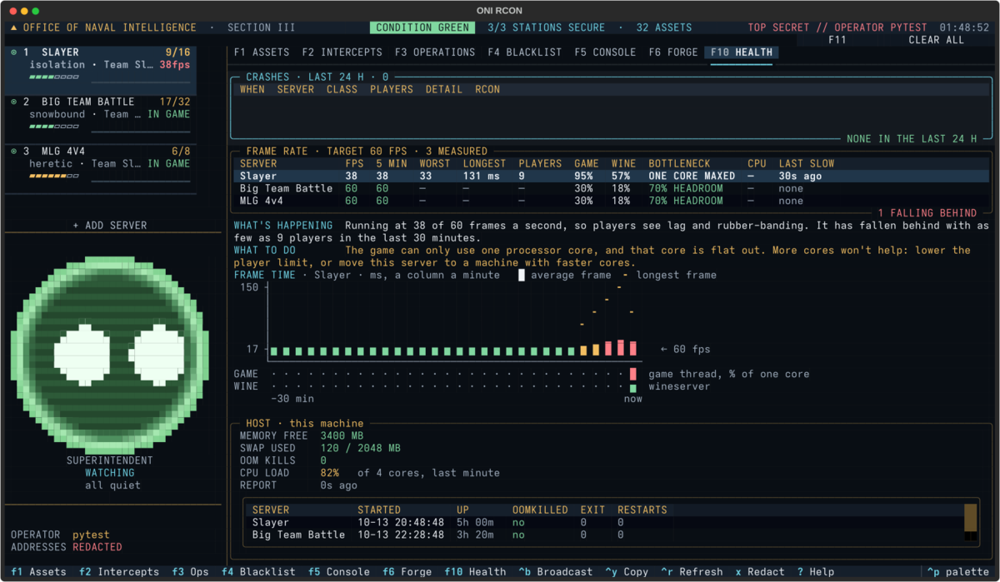

# Is my server lagging? A plain guide

This guide explains what the **F10 HEALTH** page tells you about how smoothly your Halo 3 server runs, and what to
do when it doesn't. You don't need to know anything technical to use it.

## The short version

- Your server updates the game **60 times a second**. Each update is a **frame**.
- If it can't keep up, players see **lag**: rubber-banding, shots that don't register, and people jumping around.
- F10 shows each server's frame rate. **Green is fine, amber is slipping, red is laggy.**
- Under the table, **WHAT'S HAPPENING** and **WHAT TO DO** explain the selected server in plain words. Use the
  arrow keys to pick a server.

## Reading the FRAME RATE table

| Column | What it means |
|---|---|
| **FPS** | Frames a second over the last minute. 60 is perfect. Under 54 players start to notice; under 40 it's clearly laggy. |
| **5 MIN** | The average over the last five minutes, so one bad moment doesn't look like a disaster. |
| **WORST** | The slowest it got recently. |
| **LONGEST** | The longest single pause. Anything over 50 ms is a hitch players can feel. |
| **PLAYERS** | How many were on when it slowed down. |
| **GAME** | How hard the game is working its **one** processor core (see below). 90% or more means it's at its limit. |
| **WINE** | How hard Wine is working. Wine is the layer that lets this Windows game run on Linux. |
| **BOTTLENECK** | What's holding the server back, in one phrase. See the table below. |
| **LAST SLOW** | When it last fell behind. "none" means not in the last half hour. |

A slow server also shows its frame rate on its card in the left-hand list (for example `38fps`), and on **F3**
(SERVER FPS and GAME THREAD).

## The chart

**FRAME TIME** shows the last 30 minutes, one column per minute.

- **Bars** are how long a frame took on average. Short and green is good.
- The **dotted line** marked "60 fps" is the target. Bars that rise well above it mean lag.
- The **`╸` marks** are the longest pause in that minute.
- The **GAME** and **WINE** strips underneath show how busy those were, so you can see whether lag lines up with
  the processor being maxed out.

## Why "more cores" usually doesn't help

This is the part that surprises most people.

The game does almost all of its work on **one processor core**. Wine, which the game leans on constantly, is also
mostly a one-core program. The two take turns on that core's speed. So a machine with 88 cores can still lag if each
core is slow, because a busy lobby only gets to use about one of them.

That means:

- **Faster cores help.** A desktop-class CPU (for example a recent Ryzen) runs a big lobby much better than an older
  server CPU with lots of slow cores.
- **Fewer players help.** Every player adds work to that one core.
- **More cores don't help a single lobby.** They let you run *more lobbies* side by side, but each lobby is still
  limited to roughly one core's speed.

Real example, 14 October 2026: a 90-player lobby on an older dual-Xeon machine fell to around 36 fps. Its game used
79% of one core and Wine used 59%, while the machine itself was mostly idle. The fix was a lower player cap, not more
hardware.

## What each BOTTLENECK means

| You see | In plain words | What to do |
|---|---|---|
| **60% HEADROOM** (green) | Running smoothly, with room to spare. | Nothing. The number is how much of its core is still free. |
| **ONE CORE MAXED** | The game is using its whole core. | Lower the player limit, or move the server to a machine with faster cores. |
| **GAME+WINE ONE CORE** | The game and Wine are taking turns and have used up the core between them. | Same as above: fewer players or faster cores. |
| **HOST BUSY** | Other things on the same machine are hogging the processor, so the game has to wait its turn. | Move a busy lobby to another machine, or stop something you don't need. |
| **CPU CAP** | The server has a processor limit set, and it's hitting it. | Raise that server's CPU limit. |
| **NOT CPU** | It's slow, but the processor isn't the reason. | Check memory (the HOST box on F10), the network, or a heavy map or mod in the rotation. |
| **—** | Not measured yet. | Wait a minute for the second reading. Customer servers: make sure you're up to date (F9). |

## How many players can my server handle?

It depends on the CPU, the map and the game mode. A rough guide from our fleet, at a steady 60 fps:

| CPU | Comfortable lobby size |
|---|---|
| Ryzen 9 9950X / 9950X3D | about 40 players |
| Xeon E5-2696 v4 | about 24–32 players |
| Xeon E5-4640 v2 | about 16 players |

Heavy mods (Star Wars, Battlefront and similar) need far more: expect to halve those numbers or worse.

The easiest way to find your own limit: watch F10 while the lobby fills. **WHAT'S HAPPENING** tells you the smallest
crowd it has fallen behind with recently ("It has fallen behind with as few as 64 players"). Set your player cap a
little below that.

## Where the numbers come from

- **Frame rate:** the server itself writes a line to its log for every minute it spends under 54 frames a second.
  The console reads those lines. A minute with no such line kept up, so it counts as 60.
- **GAME and WINE:** the console reads Linux's own record of how much time those two programs spent running and
  waiting. It reads and measures only; it never changes anything.
- Customer VPSes get these through `oni` automatically (version 0.9.0+ibigs.13 or newer; update with F9).
- The IBIGS fleet console gets them from each machine's agent.

Nothing here slows your server down. The readings are taken once a minute (customer) or every 15 seconds (fleet).
